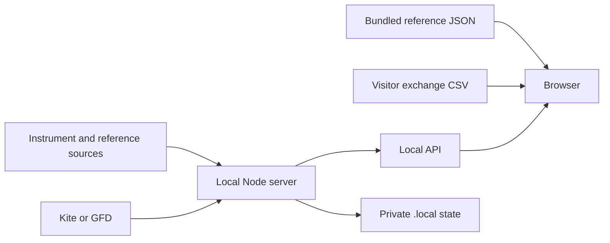

# Architecture

Updated 2 November 2026. Describes the checked-in implementation.

## Runtime and flow

The browser loads dist/index.html, CSS, JavaScript modules and JSON assets. Node's server.mjs serves the same directory and adds private API routes. package.json requires Node 22+ and has no third-party runtime dependencies. The build:pages script generates public entry documents; browser assets remain authored directly in dist.

Static hosting supplies only the browser side. Background jobs and provider connections exist only while the Node process runs.

## Module map

| Files | Responsibility |
|---|---|
| server.mjs | HTTP serving, route selection, GFD socket and refresh scheduling |
| feed.mjs | GFD quote normalization and ordered quote storage |
| kite.mjs | Login exchange, private session, binary quote parsing, socket groups and history |
| listings.mjs | Directory normalization, daily refresh and first-seen events |
| reference-data.mjs / ipo-calendar.mjs | Official share references and IPO provenance |
| coverage-audit.mjs | Missing-input and identity coverage report |
| build-public-pages.mjs / dist/route-entry.js / page-metadata.js | Static entry generation, stable asset roots and route metadata |
| dist/market-ticker.js | Stock/index ticker, index pages and comparison candidates |
| dist/data-loader.js | Validated source loading with early core rendering and supporting-data hydration |
| dist/app.js | Browser state, routing, rankings and main views |
| dist/company-page.js / kite-ui.js | Company surfaces and broker quote/history views |
| dist/ranking-universe.js / live-valuation.js | Identity matching and valuation inputs |
| dist/chart-core.js / chart-interactions.js / chart-export.js | Scales, interaction and downloads |
| dist/market-map.js / chart-audit.js | Map layout and chart support |
| dist/exchange-eod.js / market-status.js | Official CSV handling and calendar status |
| dist/currency-format.js / fx-reference.js | Currency formatting and reference conversion |

## Persistence

Bundled data is under dist. Browser preferences/imports are local to the browser. The server uses ignored .local state for instrument masters, discovery state, reference-sync status and the private Kite session. Reference jobs can update JSON under dist; review these outputs before a public data release. Read .env only on the server. Never copy .local or .env to a public artifact.

## Scheduling and provider precedence

The directory job checks every minute and attempts the daily refresh after 08:35 IST; a startup refresh may also run. Reference refresh eligibility is checked hourly, with an initial delayed check and a UTC-date guard. Browser refreshes pause for some hidden-tab paths; consult the implementation when changing cadence.

/api/market selects Kite whenever both Kite credentials are configured, otherwise GFD. There is no automatic Kite-to-GFD failover after a login error. GFD transport receives provider updates; browser market polling is every five seconds. Kite subscribes in up to three groups of 3,000 tokens in this implementation and reports unsubscribed instruments. These are implementation limits, not a promise about a subscription's entitlements.

The local server binds 127.0.0.1 and restricts Host to localhost/127.0.0.1. It is not a ready-made public multi-user server.

## Incremental quote delivery

market-deltas.mjs tracks the latest record and revision per company/index instrument. Opt-in polling receives changed records; dist/market-updates.js reconstructs complete arrays before existing views consume them. Cursor mismatch or incomplete updates reset the in-memory adapter and force a full refresh. No event log grows with time, and no quote cache is added to browser storage. See PERFORMANCE_AUDIT.md for measured transfers and limits.

## Public entry-page generation

build-public-pages.mjs creates static identity pages from the same verified, deduplicated ranking universe used by the app. route-entry.js freezes the document asset base, hydrates a direct path into the existing hash router and mirrors known routes with history replacement. public-pages-manifest.json gates path updates so newly discovered companies without generated pages retain working hash links. page-metadata.js supplies both static and runtime metadata. Financial values and broker sessions are not embedded in generated HTML.
